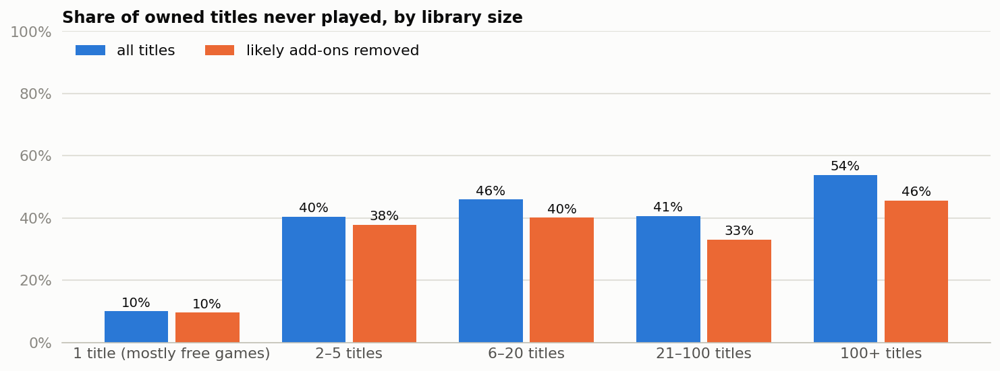

# Steam library activation: how much of what players buy gets played?

Across 128,804 owned titles and 12,393 players, 45.3% were never played. That figure is inflated, because the most never-played titles are DLC, which can't log play time. With likely add-ons removed, it's **about 38% to 42%**, depending on how free-looking titles are treated. **The recommendation is to test a prompt for unplayed titles across all library sizes.** The rate is about the same for mid-size and large libraries (39.0% and 40.0%), so the data doesn't support starting with big collectors. This is observational data, and it can't show whether getting those titles played makes money.



**Read next:** [decision memo](case_study.md) (one page, for a studio head) · [analysis code](src/analysis.py) · [every number](out/results.json)

**A note on the adjustment:** removing add-ons wasn't part of the original plan. I added it after DLC topped the raw ranking, and both figures are reported.

Decision rules are fixed at the top of [the analysis script](src/analysis.py), and each script stops if its data checks fail. This is independent analysis of public data, and isn't affiliated with any company or game named here.

## How to reproduce

```bash
python3 -m venv .venv && source .venv/bin/activate
```

```bash
pip install -r requirements.txt
```

```bash
tools/get_data.sh
```

```bash
python src/analysis.py
```

## Repo structure

```text
.
├── case_study.md        one-page decision memo
├── src/analysis.py      data checks, analysis, charts
├── src/gamestats.py     statistics helpers and chart style
├── tools/get_data.sh    downloads the source data (not redistributed)
├── out/                 results.json, charts, tables
└── data/                where the download goes
```

## Skills

Funnel analysis · data-quality diagnosis · concentration analysis · bootstrap · Python

## More case studies

- [Cookie Cats gate A/B test](https://github.com/rahulkundanjha-blip/cookie-cats-ab-test)
- [Steam player decay after launch](https://github.com/rahulkundanjha-blip/steam-player-decay)
- [League of Legends first 10 minutes](https://github.com/rahulkundanjha-blip/lol-first-10-minutes)
- [Lichess matchmaking and first-move fairness](https://github.com/rahulkundanjha-blip/lichess-matchmaking)

## Contact

KinetiArc
