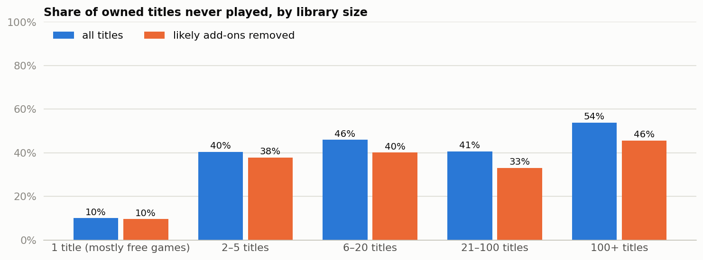

# Steam library activation: how much of what players buy gets played?

*Rahul Jha, KinetiArc. Independent analysis of public data; not affiliated with Valve or any game named here.*

## 1. Decision

**Test a prompt for unplayed titles across all library sizes, because about 38% to 42% of owned titles are never played, well above the 25% rule set in advance.** Treat this as a platform-level test, not a business case: the data can't show whether more first plays bring in more money.

## 2. What we looked at

128,804 owned titles across 12,393 Steam players, after removing 719 duplicate rows.
Each title is either played, with lifetime hours, or never played.

## 3. What happened

| Players by library size (likely add-ons removed) | 2–20 titles | 21+ titles |
|---|---|---|
| Share of players | 44.1% | 8.9% |
| Share of owned titles | 27.3% | 67.6% |
| Share of unplayed titles | 27.9% | 70.8% |
| Never-played rate | 39.0% | 40.0% |
| Median unplayed titles per player | 1 | 14 |

- **Size doesn't change the rate:** players with 21+ titles hold most unplayed titles only because they hold most titles. They offer more inventory, while players with 2–20 titles offer about five times the reach.
- **One-title players aren't a real comparison:** their 9.6% rate is mostly free games, with 60.4% of them owning only Dota 2 or Team Fortress 2.
- **Playtime is concentrated:** the top 10% of players hold 65.3% to 70.7% of hours, above the 50% rule. Dota 2, Counter-Strike: Global Offensive and Team Fortress 2 alone hold 42.9%.

## 4. Can we trust it?

- **The range:** the raw figure is 45.3%. Removing 1,612 likely add-ons gives 38.2% (range 36.8% to 39.5%). Also removing 28 titles almost everyone plays, which may be free games only logged once played, gives 41.7%. The add-on rule was added after seeing DLC top the ranking, and the conclusion holds at every figure.
- **Still unclear:** bundled games, such as Ricochet at 96.0%, still count as unplayed. Some paid games show 0.0% never played, so logging may differ by title.
- **Playtime:** hours are lifetime totals, so players on older accounts look more valuable than they may be.

## 5. What it means for the business

An unplayed title has usually already been paid for, so it brings in no new revenue by itself. The case for action depends on whether playing a backlog title leads to future purchases or longer engagement. This data has no prices or dates, so that link is the open question, and it should decide whether this is worth building.

## 6. Next experiment

Hypothesis: a "play next" prompt raises first plays and later purchases. Randomise by player, and report 2–20 and 21+ titles separately. Metric: unplayed titles started within 30 days. Guardrails: total playtime, purchases and refunds. Sample size depends on variation between players in the live population.

## 7. Limitations

- No dates, prices, bundle flags or genres, and nothing that labels DLC or free games.
- The sampling method and collection date are unknown, so results may not represent all Steam players.
- The file came from a course repository's copy of a public Steam dataset. Its shape matches what's expected, but I didn't compare it against the original.
- Library size is descriptive: it doesn't show that buying more causes less play.
